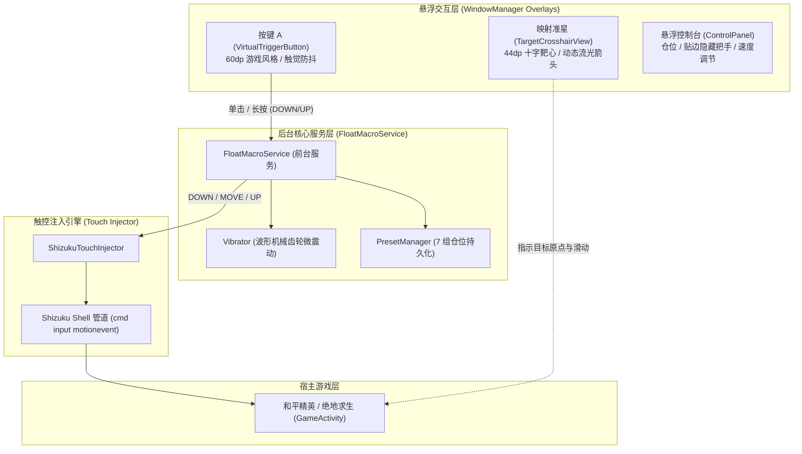

# RecoilMaster (压枪大师) 🎯

> **RecoilMaster (AutoMacro)** is a high-performance, native Android gaming macro and recoil control automation system. Designed specifically for tactical shooters (e.g., Peacekeeper Elite / PUBG Mobile), it provides floating overlays, what-you-see-is-what-you-get (WYSIWYG) target mapping, dual-state trigger controls, and tactile waveform haptics.

[](https://developer.android.com)
[](https://kotlinlang.org)
[](https://shizuku.rikka.app/)
[](LICENSE)

---

## 🌟 Key Features (核心特性)

### 1. Dual-State Trigger Mechanism (双态智能触发按键 A)
- **A 键单击 = 映射键原位单击（单点射击）**：短按轻点（<80ms），游戏内映射键在原位触发标准单击，零位移、不滑动，完美适配单发枪械点射与常规界面点击。
- **A 键按住 = 映射键持续向下滑动（全自动压枪）**：长按（>80ms），系统无缝切换至全自动模式，线性马达启动机械阻尼循环微震动（Waveform Haptic），映射键按设定速度逐帧平滑向下拉枪，有效抑制后坐力。
- **A 键松手 = 映射键松手（立刻刹车复位）**：手指离屏瞬间毫秒级派发 `ACTION_UP`，滑动与微震动立刻彻底终止，触控指针瞬间归位回到初始原点，随时待命下一次操作。

### 2. WYSIWYG Target Mapping (所见即所得准星映射)
- **按键 A（60dp 质感圆形按键）**：自由拖拽至大拇指最舒适的操作区域。
- **映射准星（44dp 十字靶心）**：直接拖动至游戏开火键或屏幕瞄准区域；长按时动态流光亮起，内部实时渲染滑动箭头（`↓` / `↑`）与“压枪”状态提示。

### 3. Reversible Sliding Direction (滑动方向一键秒切)
- 默认锁定为 **⬇ 向下压枪（向下滑动）**。
- 控制台内提供专属大按钮，随时一键切换为 **⬆ 向上滑动**，满足不同武器模式与操作习惯。

### 4. 7 Independent Preset Profiles (7 组独立预设仓位)
- 提供 1 ~ 7 号快速切换按钮，支持针对步枪、连狙、冲锋枪等不同武器一键载入配置。
- 每个仓位独立持久化保存：**A键坐标、映射靶心坐标、压枪速度、透明度、滑动方向**。

### 5. Ultra-Slim Edge Dock Tab (极简纤细贴边收纳)
- 悬浮控制面板拖动至屏幕边缘或点击“贴边隐藏”，自动收缩为 **18dp × 42dp** 迷你半透明胶囊小把手。
- 轻触小把手秒级唤出面板，按住可贴边上下任意调节高度，绝不遮挡游戏视野与操作区域。

### 6. Pure Native Performance & Shizuku Powered (原生极速引擎)
- 基于 **Kotlin + Jetpack** 原生打造，无需 AutoX.js 或第三方解释器。
- 采用 Shizuku 高效底层触控管道，指令级毫秒响应；内置 Nubia/ZTE 游戏清理机制保活策略（`FOREGROUND_SERVICE_TYPE_SPECIAL_USE`）。

---

## 🏗️ Architecture (技术架构)



---

## 🚀 Build & Installation (构建与编译)

### 环境依赖
- Android SDK (API 34 / Android 14)
- JDK 17+
- Gradle 8.2+
- 已激活运行的 [Shizuku](https://shizuku.rikka.app/) 服务

### 编译 Debug APK
```bash
# 在项目根目录下执行
gradle assembleDebug

# 生成的 APK 输出路径：
# app/build/outputs/apk/debug/app-debug.apk
```

### 安装与运行
```bash
# 安装到已连接的真机
adb install -r -t app/build/outputs/apk/debug/app-debug.apk

# 授权 Shizuku 权限
adb shell pm grant com.automacro.app moe.shizuku.manager.permission.API_V23

# 启动主界面或前台悬浮窗服务
adb shell am start -n com.automacro.app/.MainActivity --ez auto_start true
```

---

## 📄 License
This project is licensed under the MIT License - see the LICENSE file for details.
